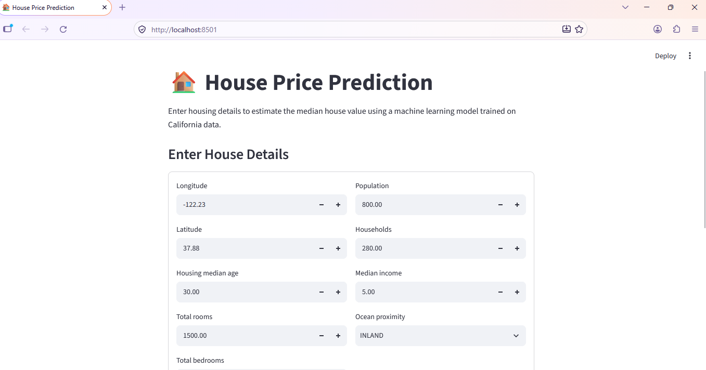

# 🏠 House Price Prediction Using Machine Learning

## Project Overview

An end-to-end machine learning project that predicts median house values in California using regression algorithms. The project includes data preprocessing, model training, evaluation, and an interactive Streamlit web application.

## Technologies Used

- Python
- Pandas and NumPy
- Matplotlib and Seaborn
- Scikit-learn
- Streamlit
- Joblib
- Git and GitHub

## Machine Learning Algorithms

- Linear Regression
- Decision Tree Regressor
- Random Forest Regressor

## Dataset

The project uses the California Housing Prices dataset.

**Dataset source:** [California Housing Prices — Kaggle](https://www.kaggle.com/datasets/camnugent/california-housing-prices)

The target variable is `median_house_value`.

Place the compatible `housing.csv` file at `data/raw/housing.csv`. The dataset is excluded from Git and must be downloaded separately.

## Project Structure

```text
house-price-prediction/
├── app.py
├── README.md
├── requirements.txt
├── images/
│   ├── house-price-app.png
│   └── prediction-output.png
├── data/
│   └── raw/
├── models/
├── reports/
├── notebooks/
└── src/
    ├── data_preprocessing.py
    ├── train.py
    └── predict.py
```

## Installation and Usage

### 1. Clone the repository

```bash
git clone https://github.com/Praveen-1131/House-Price-Prediction.git
cd house-price-prediction
```

### 2. Create and activate a virtual environment

```bash
python -m venv .venv
```

On Windows PowerShell:

```powershell
.\.venv\Scripts\Activate.ps1
```

### 3. Install dependencies

```bash
python -m pip install -r requirements.txt
```

### 4. Add the dataset

Place `housing.csv` in `data/raw/`.

### 5. Train the models

Run from the project root:

```bash
python -m src.train
```

### 6. Run the web application

```bash
python -m streamlit run app.py
```

Open the local URL displayed in the terminal, usually `http://localhost:8501`.

## Model Evaluation Results

The latest training run selected the Random Forest model as the best-performing model.

| Metric | Result |
|---|---:|
| Best Model | Random Forest |
| Mean Absolute Error (MAE) | $31,658.02 |
| Root Mean Squared Error (RMSE) | $49,070.76 |
| R-squared (R²) | 0.8162 |

The model achieved an R² score of approximately 81.62% on the evaluation data. Results may vary depending on the dataset and training configuration.

## Application Screenshots

### Application Interface



### Prediction Output


## Deployment

The application can be deployed using [Streamlit Community Cloud](https://share.streamlit.io/).

Before deployment, ensure the trained model is available at `models/best_model.joblib`, as required by `app.py`, and that all dependencies are listed in `requirements.txt`.

## Key Learning Outcomes

- Data cleaning and preprocessing
- Exploratory data analysis
- Regression model training and evaluation
- Model serialization and loading
- Interactive web application development
- Git and GitHub version control

## Future Improvements

- Hyperparameter tuning
- Additional data visualizations
- Automated testing
- Online deployment
- Improved prediction interface

## Disclaimer

This project is for educational purposes and uses California housing data. It is not intended to estimate property prices in India without suitable local data and retraining.

## Author

**Praveen**

- GitHub: [Praveen-1131](https://github.com/Praveen-1131)
- Project: [House Price Prediction Repository](https://github.com/Praveen-1131/House-Price-Prediction)